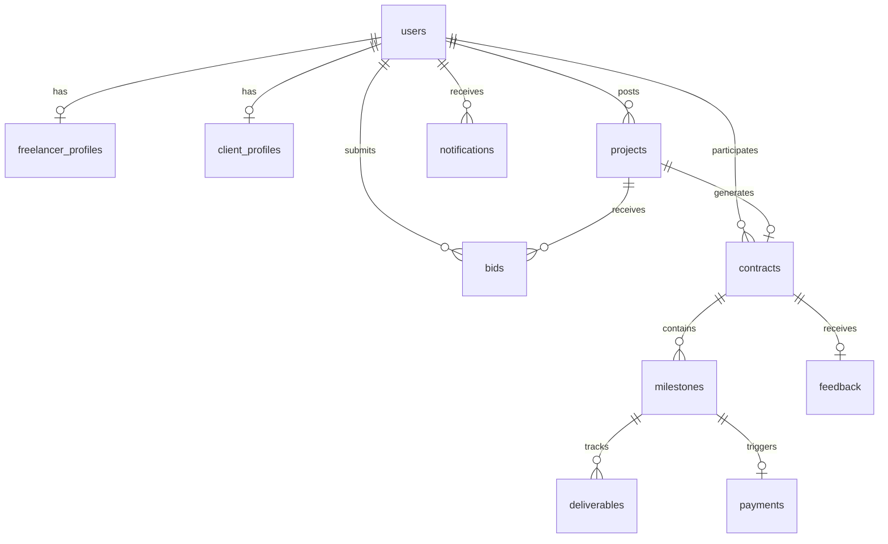

# Database Schema & Entity Documentation
## PostgreSQL Database Design

- **Student Name:** GUNDA VENKATARAMANA
- **Enrolment Number:** 2303A51893
- **Project Number:** 46

---

## 1. Entity-Relationship Diagram (Mermaid)

---

## 2. Table Specifications

### 2.1 `users`
| Column | Type | Constraints | Description |
| :--- | :--- | :--- | :--- |
| `id` | INTEGER | PRIMARY KEY, AUTO_INCREMENT | Unique user identifier |
| `name` | VARCHAR(255) | NOT NULL | User's full display name |
| `email` | VARCHAR(255) | UNIQUE, NOT NULL | Account email (login username) |
| `password` | VARCHAR(255) | NOT NULL | 10-round bcrypt salted hash |
| `role` | ENUM | NOT NULL | `'admin'`, `'client'`, `'freelancer'`, `'payment_reviewer'` |
| `phone` | VARCHAR(50) | NULL | Contact phone number |
| `avatar` | VARCHAR(255) | NULL | Profile image URL |
| `isActive` | BOOLEAN | DEFAULT TRUE | Account activation switch for admin |
| `createdAt` | TIMESTAMP | DEFAULT NOW() | Record creation timestamp |
| `updatedAt` | TIMESTAMP | DEFAULT NOW() | Last update timestamp |

### 2.2 `freelancer_profiles`
| Column | Type | Constraints | Description |
| :--- | :--- | :--- | :--- |
| `id` | INTEGER | PRIMARY KEY, AUTO_INCREMENT | Profile identifier |
| `userId` | INTEGER | FOREIGN KEY (`users.id`), UNIQUE | Associated user account |
| `title` | VARCHAR(255) | DEFAULT 'Full Stack Developer' | Professional headline |
| `bio` | TEXT | NULL | Professional biography |
| `hourlyRate` | FLOAT | DEFAULT 35.0 | Baseline hourly rate in USD |
| `skills` | TEXT | DEFAULT '[]' | JSON array string of technical skills |
| `rating` | FLOAT | DEFAULT 5.0 | Cumulative weighted star rating (1.0 - 5.0) |
| `totalReviews` | INTEGER | DEFAULT 0 | Count of received client reviews |
| `completedProjectsCount` | INTEGER | DEFAULT 0 | Successfully delivered contracts count |
| `totalEarnings` | FLOAT | DEFAULT 0.0 | Cumulative simulated payout sum |
| `onTimeDeliveryRate` | FLOAT | DEFAULT 98.5 | Historical delivery timeliness % |

### 2.3 `client_profiles`
| Column | Type | Constraints | Description |
| :--- | :--- | :--- | :--- |
| `id` | INTEGER | PRIMARY KEY, AUTO_INCREMENT | Profile identifier |
| `userId` | INTEGER | FOREIGN KEY (`users.id`), UNIQUE | Associated user account |
| `companyName` | VARCHAR(255) | NULL | Organization or business name |
| `industry` | VARCHAR(255) | NULL | Business sector |
| `website` | VARCHAR(255) | NULL | Corporate website URL |
| `totalSpent` | FLOAT | DEFAULT 0.0 | Total simulated payments disbursed |
| `totalProjectsPosted` | INTEGER | DEFAULT 0 | Cumulative project listings created |

### 2.4 `projects`
| Column | Type | Constraints | Description |
| :--- | :--- | :--- | :--- |
| `id` | INTEGER | PRIMARY KEY, AUTO_INCREMENT | Project identifier |
| `clientId` | INTEGER | FOREIGN KEY (`users.id`), NOT NULL | Client who posted project |
| `title` | VARCHAR(255) | NOT NULL | Project title |
| `description` | TEXT | NOT NULL | Detailed specifications and scope |
| `category` | VARCHAR(100) | DEFAULT 'Web Development' | Technical domain |
| `scope` | ENUM | `'Entry'`, `'Intermediate'`, `'Expert'` | Complexity level |
| `budget` | FLOAT | NOT NULL | Fixed benchmark budget in USD |
| `deadline` | DATE | NOT NULL | Project target delivery date |
| `skillsRequired` | TEXT | DEFAULT '[]' | JSON array string of required skills |
| `status` | ENUM | `'Open'`, `'In Progress'`, `'Completed'`, `'Cancelled'` | Current project state |
| `bidsCount` | INTEGER | DEFAULT 0 | Total proposals received |

### 2.5 `bids`
| Column | Type | Constraints | Description |
| :--- | :--- | :--- | :--- |
| `id` | INTEGER | PRIMARY KEY, AUTO_INCREMENT | Bid identifier |
| `projectId` | INTEGER | FOREIGN KEY (`projects.id`), NOT NULL | Targeted project |
| `freelancerId`| INTEGER | FOREIGN KEY (`users.id`), NOT NULL | Bidding freelancer |
| `bidAmount` | FLOAT | NOT NULL | Freelancer quote in USD |
| `deliveryDays`| INTEGER | NOT NULL | Estimated business days to deliver |
| `coverLetter` | TEXT | NOT NULL | Pitch & technical approach |
| `status` | ENUM | `'Pending'`, `'Accepted'`, `'Rejected'` | Proposal status |

### 2.6 `contracts`
| Column | Type | Constraints | Description |
| :--- | :--- | :--- | :--- |
| `id` | INTEGER | PRIMARY KEY, AUTO_INCREMENT | Contract agreement ID |
| `projectId` | INTEGER | FOREIGN KEY (`projects.id`), NOT NULL | Associated project |
| `clientId` | INTEGER | FOREIGN KEY (`users.id`), NOT NULL | Hiring client |
| `freelancerId`| INTEGER | FOREIGN KEY (`users.id`), NOT NULL | Contracted freelancer |
| `bidId` | INTEGER | FOREIGN KEY (`bids.id`), NULL | Accepted proposal reference |
| `contractValue`| FLOAT | NOT NULL | Agreed total contract payout |
| `status` | ENUM | `'Active'`, `'Completed'`, `'Terminated'` | Agreement status |
| `startDate` | DATE | NOT NULL | Agreement execution date |
| `endDate` | DATE | NULL | Completion or termination date |
| `terms` | TEXT | NULL | Special contractual stipulations |

### 2.7 `milestones`
| Column | Type | Constraints | Description |
| :--- | :--- | :--- | :--- |
| `id` | INTEGER | PRIMARY KEY, AUTO_INCREMENT | Milestone ID |
| `contractId` | INTEGER | FOREIGN KEY (`contracts.id`), NOT NULL | Parent contract |
| `title` | VARCHAR(255) | NOT NULL | Milestone description |
| `amount` | FLOAT | NOT NULL | Escrow tranche release amount |
| `dueDate` | DATE | NOT NULL | Deliverable deadline |
| `status` | ENUM | `'Pending'`, `'In Progress'`, `'Deliverable Submitted'`, `'Approved'`, `'Paid'`, `'Revision Requested'` | Milestone status |
| `revisionNotes`| TEXT | NULL | Feedback on requested revisions |

### 2.8 `deliverables`
| Column | Type | Constraints | Description |
| :--- | :--- | :--- | :--- |
| `id` | INTEGER | PRIMARY KEY, AUTO_INCREMENT | Deliverable ID |
| `milestoneId` | INTEGER | FOREIGN KEY (`milestones.id`), NOT NULL | Targeted milestone |
| `freelancerId`| INTEGER | FOREIGN KEY (`users.id`), NOT NULL | Submitting freelancer |
| `submissionNotes`| TEXT | NOT NULL | Summary of completed work |
| `fileUrl` | VARCHAR(255) | NULL | Artifact / PR link |
| `status` | ENUM | `'Submitted'`, `'Accepted'`, `'Revision Requested'` | Deliverable review status |
| `clientFeedback`| TEXT | NULL | Client review commentary |

### 2.9 `payments`
| Column | Type | Constraints | Description |
| :--- | :--- | :--- | :--- |
| `id` | INTEGER | PRIMARY KEY, AUTO_INCREMENT | Payment record ID |
| `transactionId`| VARCHAR(100) | UNIQUE, NOT NULL | Unique audit tracking string |
| `milestoneId` | INTEGER | FOREIGN KEY (`milestones.id`), NOT NULL | Related milestone |
| `contractId` | INTEGER | FOREIGN KEY (`contracts.id`), NOT NULL | Related contract |
| `clientId` | INTEGER | FOREIGN KEY (`users.id`), NOT NULL | Payer |
| `freelancerId`| INTEGER | FOREIGN KEY (`users.id`), NOT NULL | Beneficiary |
| `amount` | FLOAT | NOT NULL | Disbursed amount |
| `status` | ENUM | `'Pending Review'`, `'Approved'`, `'Rejected'` | Escrow state |
| `reviewerId` | INTEGER | FOREIGN KEY (`users.id`), NULL | Reviewer auditor |
| `reviewedAt` | TIMESTAMP | NULL | Sign-off timestamp |
| `reviewerNotes`| TEXT | NULL | Audit verification comments |

### 2.10 `feedback`
| Column | Type | Constraints | Description |
| :--- | :--- | :--- | :--- |
| `id` | INTEGER | PRIMARY KEY, AUTO_INCREMENT | Review ID |
| `contractId` | INTEGER | FOREIGN KEY (`contracts.id`), NOT NULL | Associated contract |
| `clientId` | INTEGER | FOREIGN KEY (`users.id`), NOT NULL | Reviewing client |
| `freelancerId`| INTEGER | FOREIGN KEY (`users.id`), NOT NULL | Rated freelancer |
| `rating` | INTEGER | CHECK (1 <= rating <= 5) | Star rating |
| `comment` | TEXT | NOT NULL | Written review |

### 2.11 `notifications`
| Column | Type | Constraints | Description |
| :--- | :--- | :--- | :--- |
| `id` | INTEGER | PRIMARY KEY, AUTO_INCREMENT | Notification ID |
| `userId` | INTEGER | FOREIGN KEY (`users.id`), NOT NULL | Recipient user |
| `title` | VARCHAR(255) | NOT NULL | Short title |
| `message` | TEXT | NOT NULL | Body text |
| `type` | ENUM | `'project'`, `'bid'`, `'contract'`, `'milestone'`, `'payment'`, `'feedback'`, `'system'` | Category |
| `isRead` | BOOLEAN | DEFAULT FALSE | Read indicator |
| `link` | VARCHAR(255) | NULL | Navigational route |

